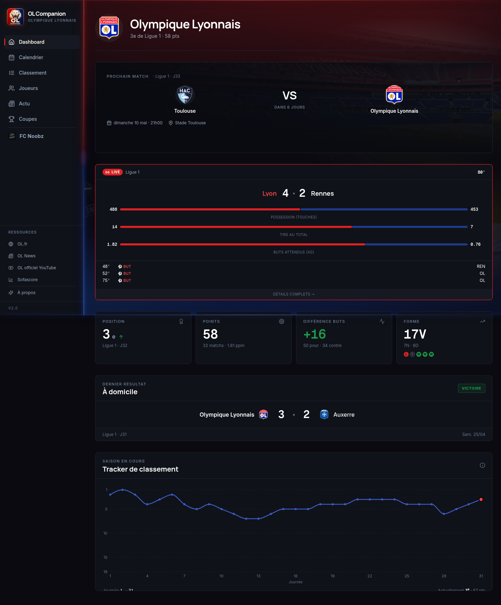
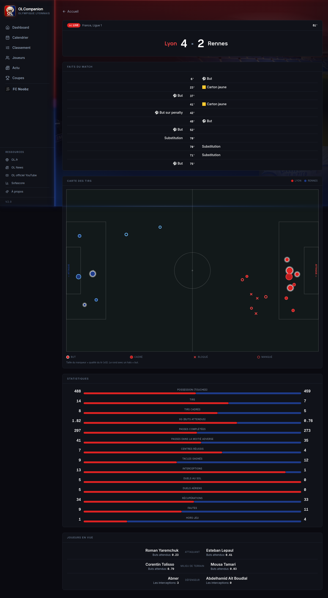
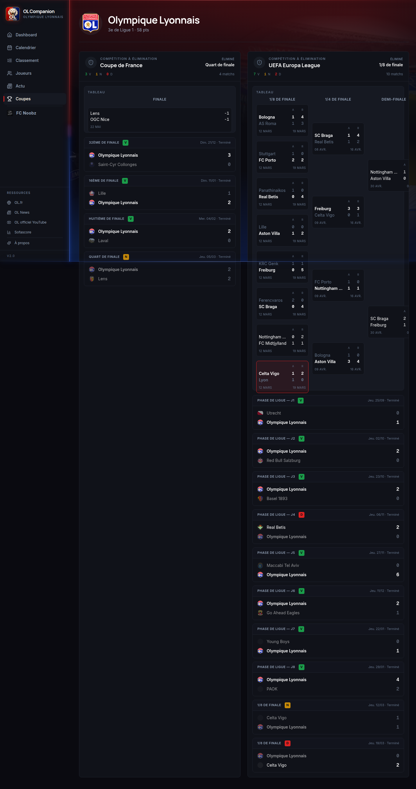
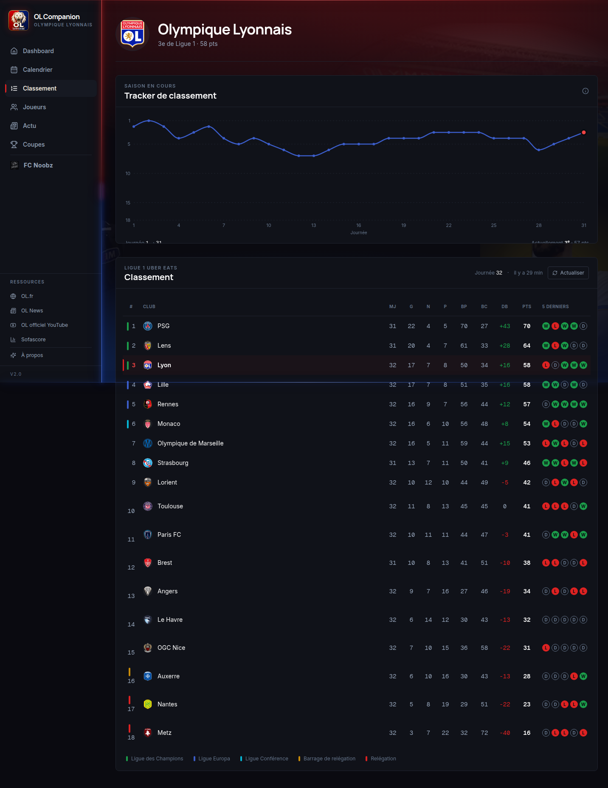
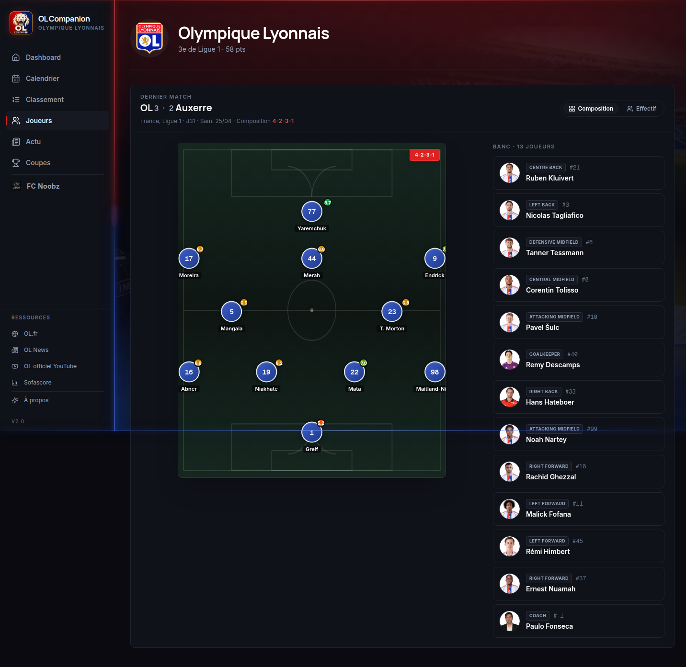
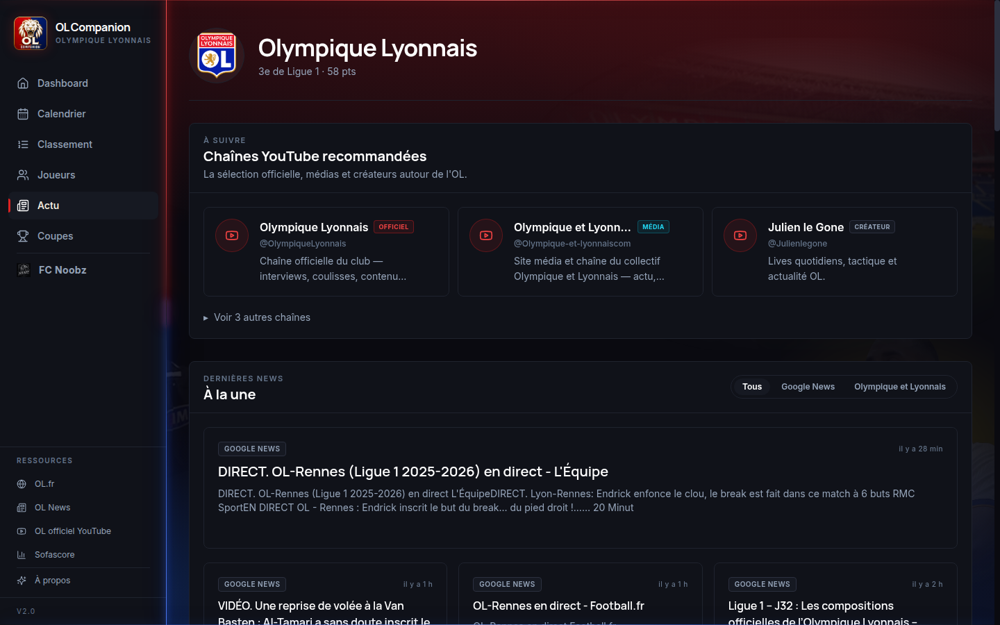

# OL Companion

[](https://claude.com/claude-code)
[](https://chat.openai.com)
[](https://react.dev)
[](https://nestjs.com)
[](LICENSE)

> Compagnon perso pour suivre l'Olympique Lyonnais : live match, calendrier, classement Ligue 1 (avec règles LFP de départage), effectif, news, coupes (avec bracket). Plus une section privée FC Noobz pour suivre l'équipe loisirs entre amis.

**100% du code écrit en pair-programming avec [Claude Code](https://claude.com/claude-code).** Direction artistique humaine + logo et premières maquettes UX par [ChatGPT](https://chat.openai.com), implémentation Claude. Voir [HOW-IT-WORKS.md](./HOW-IT-WORKS.md) pour le détail de qui fait quoi (spoiler : **aucun appel Claude au runtime** — tout est scraping 365scores déterministe).



> Dashboard pendant un match : carte live (statut, score, possession, tirs, xG, derniers events) + tracker de classement saison. Mis à jour en push via SSE quand quelque chose bouge côté 365scores.

## Pourquoi

Dev Java/web depuis 2005, je voulais explorer [Claude Code](https://claude.com/claude-code) sur un stack moderne (**React 18 + Vite + Tailwind + shadcn**) avec un sujet vraiment perso : suivre l'OL au jour le jour, sans dépendre d'apps mainstream qui pollue d'ads ou imposent un parcours.

L'identité visuelle reprend les **codes du club** (rouge + bleu lyonnais) avec une mise en scène inspirée d'un néon "Olympique Lyonnais" qui éclaire le fond de page. Référence design : Sofascore, Football Manager, Linear.

En amont du code, [ChatGPT](https://chat.openai.com) a aidé à générer le **logo OL Companion** et les premières maquettes UX qui ont guidé la construction.

## Fonctionnalités

- **Dashboard** — prochain match, toutes compétitions confondues (L45 : le bandeau lit `/api/season-matches`, comme le calendrier — un match de Ligue Europa, de Ligue des champions ou de Coupe de France plus proche que la prochaine journée de Ligue 1 passe devant ; sans journée, le tour s'écrit à la place de « J… ») (lieu = le vrai stade du club qui reçoit, tiré de la table des clubs ; rien s'il est inconnu), dernier résultat (L131 : lui aussi lu dans `/api/season-matches`, toutes compétitions — un match européen ou de coupe plus récent que le dernier match de Ligue 1 passe devant ; sans journée, le tour s'écrit à la place de « J… » ; au téléphone la date du pied de carte ne se coupe jamais, c'est le tour long qui passe à la ligne, L134 ; un match de coupe fini à égalité mais décidé aux tirs au but — 365scores désigne le qualifié, le score ne les compte pas — s'écrit « Victoire / Défaite aux tirs au but » avec « Qualifié / Éliminé aux tirs au but » sous le score, au lieu de « Match nul » ; sur une manche retour nulle, seulement si le cumul des deux manches est nul, jamais sur un match à journée (championnat, phase de ligue européenne), et le flux SSE `season-matches-changed` part aussi quand le qualifié arrive après le score, L135/L139 ; à 390 px le badge du résultat ne se coupe jamais en deux lignes et « Dernier résultat » non plus — trop long pour la ligne, le badge passe sous le titre — et son texte est à ≥ 4,5:1 sur sa teinte, jetons `--win-fg` / `--draw-fg` / `--loss-fg`, WCAG 1.4.3, L138 ; mêmes jetons pour les pastilles V/N/D du détail de saison de la fiche joueur, fond à 10 %, `--win-fg` éclairci à 40 % de luminosité pour tenir au survol de ligne, L142), position au classement. Chargement (L85) : squelettes « Chargement… » pour le prochain match et le dernier résultat, tuiles à « — » sans sous-texte (jamais « Points 0 » / « Forme 0V ») ; erreur : message + « Réessayer » par bloc (prochain match et dernier résultat → le même appel `/api/season-matches`, donc en panne ensemble et rétablis ensemble par l'un ou l'autre « Réessayer » ; classement → tuiles), une erreur de rafraîchissement avec données déjà là n'efface rien ; « OL en chiffres » et le tracker de classement en erreur ont aussi message (« Impossible de charger les statistiques de la saison. » / « … l'évolution du classement. ») + « Réessayer » (R9) ; sans match à venir : « Aucun match programmé. » + lien « Voir le calendrier » (`/fixtures`) ; sans match terminé, pas de bloc « Dernier résultat »
- **Live match** — quand l'OL joue (ou vient de jouer) : carte sur l'accueil + page dédiée `/match/:gameId` avec timeline (buts, cartons, subs), shot map (xG par tir + outcome), 14 stats agrégées par équipe avec barres comparatives, top performers par rôle. Tant que le match n'a pas commencé, la carte et l'en-tête de la page affichent « vs » au lieu d'un score (365scores renvoie -1). Le bloc « Classement en direct » (Ligue 1, OL ± 2) n'est servi que pour un match de Ligue 1 (L158) : sous un match de coupe, `standings` est absent et le bloc masqué, jamais le classement d'une autre compétition. Updates via **SSE push** (cron 30 s qui diffe la signature et émet un event si quelque chose change).
- **Classement Ligue 1** avec règles LFP (différence générale, buts marqués, etc.) — données 365scores ; DB négatif au jeton `--loss-fg` et lettre L blanche sur sa pastille, ≥ 4,5:1 (WCAG 1.4.3, L145) ; le bouton « Actualiser » a pour nom accessible « Actualiser le classement » (il contient son texte visible, WCAG 2.5.3, L146 ; la forme des 5 derniers matchs s'écrit en lettres françaises V / N / D (le « D » anglais de draw se lisait Défaite), chaque pastille est une image nommée `role="img"` (Victoire / Match nul / Défaite), WCAG 1.1.1 et 4.1.2, L147) ; chargement annoncé en `role="status"`, et sans donnée une erreur affiche « Impossible de charger le classement. » (`role="alert"`) + « Réessayer » (même composant que l'accueil, L149) — avec un classement déjà affiché, un échec de rafraîchissement n'efface rien et n'affiche pas de bloc rouge : un bandeau `role="status"` de 36 px sous l'en-tête de la carte (icône d'avertissement, 12 px) dit « Rafraîchissement impossible — classement du 14 oct. à 16:25 » (heure de Paris), ou « Classement d'il y a 3 j » quand les données ont plus d'1 h ; la méta de l'en-tête montre alors la date du cache (L148). En-tête du tableau collant à la fenêtre au défilement (L153) : le tableau n’est plus dans un conteneur `overflow-x-auto`, qui retenait le collant dans son propre cadre ; il tient sans défilement horizontal à 320/390 px (L37)
- **Trajectoire saison** : tracker de position (chart Recharts, line OL bleu + dot OL rouge sur la journée courante) ; le pied « Journée x → y » / « Actuellement » est sous le graphique (hors du bloc à hauteur fixe), jamais tronqué (L150) ; l'axe Journée étiquette chaque journée jusqu'à 20 points, au-delà la première, les multiples de 5 et la dernière — plus de tick sauté (J6 sans étiquette), L151 ; accessibilité (L152, WCAG 1.1.1 / 2.1.1) : le graphique est caché aux lecteurs d'écran et remplacé par un résumé texte + un tableau Journée / Place / Points (dans un `div.sr-only`, jamais `sr-only` sur la table elle-même : elle garderait sa largeur et ferait défiler la page, L156), l'info-bulle « i » est un bouton focusable dont le texte s'affiche aussi au focus clavier
- **Calendrier** — liste en blocs par mois civil (« Octobre 2026 », avec le nombre de matchs ; la colonne de date ne garde que « Mar. 04 », et chaque ligne porte sa compétition « L1 · J6 », le tour et la manche sous les équipes pour une qualification, L50) ; sous 1024 px les pastilles forment une barre collée en haut (`html` : scroll-padding 72 px en bas, et en haut la hauteur mesurée de la barre, 124 px par défaut — 163 px à 390 px avec quatre compétitions), la légende des sigles reste dans le flux, la vue rapide tient sur une ligne, et les cartes Prochain / Dernier résultat sont des liens entiers avec chevron ; les compteurs d'un groupe de pastilles suivent le choix de l'autre ; pas de bloc pour un mois sans match. Toute la saison, toutes compétitions (Ligue 1, Ligue des champions et ses qualifications, Ligue Europa, Coupe de France) dans l'ordre des dates, filtre par compétition et par statut (pastilles de 40 px de haut sous lg, au doigt — WCAG 2.5.8 ; 24 px au bureau), « Matchs listés » = nombre de lignes affichées (pastilles L1 · C1 · C3 · CdF, nom long en infobulle ; au clavier, la pastille qui a le focus porte un contour rouge de 2 px, posé autour de l’anneau gris de la pastille choisie, qui reste visible), le nul s'écrit en `--draw` (orange) au calendrier — scores des deux équipes compris dans les lignes (L108) ; un nul de coupe décidé aux tirs au but n'en est plus un à la liste ni au bilan V N D : le qualifié est teinté comme le vainqueur, l'autre comme le perdant, et le bilan le compte en victoire ou en défaite ; la colonne de droite de la ligne écrit alors « t.a.b. » sous « Terminé » (abréviation de « Qualifié aux tirs au but », texte masqué pour les lecteurs d'écran qui lisent « tirs au but »), et le nom accessible du lien ajoute « , <club> qualifié aux tirs au but » : la teinte seule ne dit pas l'issue, WCAG 1.4.1 — ne pas retirer ce libellé ni le couper sous 360 px (L139) —, et seulement pour un match terminé : un match en cours à égalité garde ses scores en gris (L109) —, aux coupes et dans les pastilles de « OL en chiffres » (L102) ; la carte « Dernier résultat » de la vue rapide écrit, en clair sous le nom du club (colonne du nom, sous la ligne « date · compétition », jamais dans la colonne du score), « Qualifié aux tirs au but » ou « Éliminé aux tirs au but » selon que le qualifié est l'OL ou non, comme le tableau de bord (L140) ; la carte Ligue 1 (marqueurs et légende « Match nul ») et la pastille de forme du tableau de bord le gardent en gris ; les chiffres V N D de la vue rapide tiennent sur une ligne, en 20 px gras (grand texte) ; la date d'une ligne (« Mar. 04 », le mois étant dans le titre du bloc depuis L50) se balise en `<time datetime="2026-08-04" title="mardi 4 août 2026">`, l'année étant ainsi donnée aux lecteurs d'écran et en infobulle (L98) ; chaque ligne, ainsi que les cartes « Prochain » et « Dernier résultat » de la vue rapide, est un lien vers la page du match (`/match/<id>?matchupId=`, zone cliquable = la rangée entière, contour rouge au clavier, le lien de la rangée est en bloc pour que le contour s'affiche), les heures s'écrivent partout « 20h45 » (calendrier, cartes, coupes, tableau de bord, séparateur « Déjà vu » de la page Nouveautés ; plus de « 18:45 », L101, L106), « Horaire à confirmer » tant que l'heure n'est pas fixée, et alors le jour n'est pas affiché comme ferme non plus : « Week-end du 05/12 » (vendredi à dimanche ; « Week-end » ne se coupe plus au trait d'union dans la colonne date, ni « Saison 2026-27 » dans l'en-tête à 768 px, L100) ou « Date à confirmer » ; même règle sur la bulle « À venir » de la carte Ligue 1 et sur le tableau de bord, qui n'affiche alors ni compte à rebours ni « Jour de match » (statut « À confirmer ») ; au téléphone (390 et 320 px) les noms de clubs ne sont plus coupés, sans ellipse (« Marseille » en nom court) ; sur un match joué, seul l'écusson du perdant est atténué (les deux écussons sur un match nul) : les noms et les scores restent à pleine opacité (≥ 4,5:1, WCAG 1.4.3) ; carte Ligue 1 au téléphone : la légende « Aller / Retour » est sous la carte (coin haut droit à partir de `sm`), elle ne masque plus l'en-tête des bulles
- **Effectif** — composition (formation field SVG dynamique) + liste des joueurs avec photos 365scores CDN ; postes en français (Gardien, Défenseur central, Entraîneur ; abréviations GB, DC, ENT…), traduits côté écran depuis les libellés anglais de 365scores
- **Coupes** — Coupe de France + Coupes d'Europe le cas échéant. Qualifications de Ligue des champions (L174, compétition 365scores 332, onglet « Ligue des champions — qualifications », placé après la Ligue Europa) : chaque match porte son tour (« 3e tour de qualification », « Barrages », mêmes libellés que le calendrier, un tour inconnu n'est pas affiché) et sa manche (« · aller » / « · retour ») ; les deux manches d'un tour forment une confrontation (même `stageFr`), le statut « Éliminé » suit la règle ci-dessous ; pas de bracket. Statut « Qualifié » (propre à cette compétition, `isQualifiersWon` dans `cup-status.ts`) : affiché quand l'OL a gagné ses barrages, c'est-à-dire que les DEUX manches des barrages (aller et retour) sont dans les résultats, que plus aucun match n'est à venir (appel des matchs à venir réussi) et que l'OL est le qualifié désigné par 365scores, à défaut devant au cumul des buts. Il remplace « En lice » (qui serait resté jusqu'à 50 jours) et « Éliminé » (qu'il aurait fini par donner), et la page ne montre pas la phase de ligue qui suit. Un aller seul joué reste « En lice » : 365scores retire un match des matchs à venir avant le coup d'envoi et ne le met dans les résultats qu'à la fin, donc pendant le retour on ne voit que l'aller, dont le cumul ne prouve rien. **Bracket schématique** affiché à partir des 1/4 (CdF) ou 1/8 (EL), avec confrontations aller/retour groupées et équipe qualifiée en gras. Le statut « Éliminé » n'est donné que si plus aucun match n'est à venir ET que la dernière confrontation à élimination directe est perdue — l'équipe qualifiée désignée par 365scores sur la dernière manche prime, ce qui couvre les tirs au but (cumul nul), à défaut le cumul des buts, et seulement quand les DEUX manches d'un aller-retour (`legNum` 1 et 2) sont dans les résultats — un aller perdu seul, pendant le match retour, laisse « En lice » (L175 ; sans qualifié lu, 50 jours sans match restent la seule issue) ; un tour gagné ou un appel des matchs à venir en échec laissent l'OL « En lice » (au plus 50 jours sans match ; seuls les barrages de qualification gagnés donnent « Qualifié », voir plus haut). Phase de ligue jouée (8 journées) : le statut vient du rang final lu au classement 365scores (573) — 1-8 « 1/8 de finale », 9-24 « Barrages », 25 et au-delà « Éliminé » dès la dernière journée ; classement illisible : « En attente du tirage » (ni « En lice » ni « Éliminé »). Accessibilité (L111) : chaque onglet de coupe porte `aria-pressed` (vrai pour la coupe affichée, WCAG 4.1.2) et la pastille « En lice » est en contour seul (`border-ol-red-bright/50`, sans fond rouge teinté), ≥ 4,5:1 sur l’onglet actif, fond `bg-ol-red/10` compris, calculé par `cups-tab-style.test.tsx` (WCAG 1.4.3). Le fond de l'onglet actif est `bg-ol-red/10` (L112, `/15` faisait tomber la pastille « En lice » à 4,49:1 et le sous-titre à 4,45:1) : `/12` n'est pas une classe générée par Tailwind (échelle 0, 5, 10, 15…), l'onglet n'avait donc aucun fond ; `cups-tab-style.test.tsx` génère le CSS Tailwind réel et vérifie que chaque classe de fond de l’onglet actif y produit un `background-color` et que les deux textes fragiles y gardent ≥ 4,5:1. Tirs au but (L140) : comme au calendrier, un nul dont 365scores désigne un qualifié (`olQualified`) n'est plus un nul — le bilan V N D de la coupe le compte en victoire ou en défaite, le badge de la ligne passe à V ou D (infobulle « Qualifié / Éliminé aux tirs au but ») et la ligne écrit « t.a.b. » après « Terminé », le qualifié en clair ; sur une manche retour dont le cumul des deux manches n'est pas nul, le qualifié l'est au cumul et le match reste un nul (`lib/cup-result.ts`). L'appel des matchs à venir est réessayé 3 fois, puis les derniers matchs connus sont conservés (copie en mémoire vidée, comme le cache, à la remise à zéro de saison du 1er août). Revue UX (L6) : l'échec de `/api/cups` s'affiche dans un panneau avec « Réessayer » (44 px, relance la requête) quand aucune coupe n'est en cache — un rafraîchissement en échec laisse les coupes affichées, sans panneau, comme Classement et Actu ; chaque carte de match est un lien entier vers `/match/<id>?matchupId=<dom>-<ext>-<id>` (lien étiré par pseudo-élément depuis le libellé de la phase, comme au calendrier : date, issue et pastille V/N/D restent du texte lu hors du lien ; la pastille V/N/D et « t.a.b. » sont posées au-dessus du lien étiré (`relative z-20`) pour que leurs infobulles s'affichent à la souris ; nom « Phase de ligue — J1, Olympique Lyonnais 2, Lille 0 — détail du match » (la phase, texte visible du lien, ouvre le nom : WCAG 2.5.3 ; comme au calendrier), qui ajoute « , <club> qualifié aux tirs au but » pour un nul décidé aux tirs au but, WCAG 1.4.1 ; contour rouge au clavier) ; les écussons viennent du CDN 365scores (`seasonTeamLogoUrl`), plus de `/api/wiki-image` ; le perdant n'est plus atténué par `opacity` (textes en `fg-muted`), le compteur D et la pastille D passent en `loss-fg`, tout le texte atténué du tableau — ligne perdante, en-têtes A/R, dates aller/retour, date d'un match à venir — en `fg-muted` (≥ 4,5:1 sur le fond réel de la tuile, `bg-ol-red/10` posé sur `surface-2` pour l'OL, 6,45:1 ; `fg-dim` y faisait 4,35:1 ; mesuré sur les classes rendues par `src/test/contraste.ts`) ; le tableau plein écran est un dialogue (`role=dialog`, `aria-modal`) rendu dans `body` au-dessus de la barre latérale, focus sur « Fermer », Tab piégé, focus rendu au bouton ; les onglets forment un groupe nommé « Choisir une coupe » qui passe à la ligne au lieu de défiler (320 px) ; en-tête de page compact et nom, statut, phase et nombre de matchs écrits une seule fois (dans l'onglet ; le titre `h3` de la carte est réservé aux lecteurs d'écran).
- **Équipe de France** (`/equipe-de-france`, L113) — les Bleus sur une page : prochain match (le jour est toujours affiché, « Jeu. 12/11 » ; seule l'heure est remplacée par « Horaire à confirmer » quand elle n'est pas fixée, L117), 5 derniers résultats (« Domicile – Extérieur », badge V/N/D vu de la France) et effectif par poste avec l'âge. Un seul appel `GET /api/france`, lu sur 365scores (équipe de France A, `competitorId` 5061), copie en mémoire de 10 min et dernière réponse connue en cas d'échec (L118 : la copie périmée est réhorodatée, 365scores n'est relancé qu'une fois par minute au lieu de 3 lectures × 2 essais à chaque requête ; un 200 sans « games » sur les résultats, ou sans « squads » sur l'effectif, est traité comme un échec (L119 : il ne vide plus l'effectif 10 min ni ne remplace la copie) ; sans copie à servir (redémarrage pendant une panne), l'échec est mémorisé 1 min : 503 sans relancer les 3 lectures × 2 essais à chaque requête, sans « games » sur les matchs à venir il est servi mais revu au bout d'une minute, et le prochain match connu de la copie est gardé tant qu'il n'est pas passé de plus de 3 h ; âge absent : `age: null`, rien n'est affiché au lieu de « 0 ans »). États de chargement, d'erreur (« Réessayer ») et vide ; l'erreur remplace les blocs (jamais au-dessus d'anciens blocs) et « Réessayer » ramène le message de chargement pendant le nouvel appel (L118), le focus clavier restant sur la zone de statut pendant le chargement puis revenant sur « Réessayer » si l'erreur revient (WCAG 2.4.3). Au téléphone, la page est dans le panneau « Plus ». **Accès au match (L167)** : chaque ligne des « Derniers résultats » est un lien (44 px au moins, chevron « › ») vers `/match/<id>?matchupId=<domicile>-<extérieur>-<id>`, et le bloc « Prochain match » porte un bouton « Voir le match » de 00:00 (Paris) le jour du coup d'envoi jusqu'à 3 h après (fenêtre calculée sur la date seule, relue chaque minute) ; une fois le coup d'envoi passé, la pastille « En direct » remplace la date. Pour que cette fenêtre ne soit pas vide, `FranceService` garde le prochain match pendant le direct : 365scores le retire de `fixtures` juste avant le coup d'envoi et ne le met dans `results` qu'à la fin, il est donc servi tel quel de 15 min avant le coup d'envoi jusqu'à +3 h tant qu'il n'est dans aucune des deux listes (la copie en mémoire expire alors à cette borne), et cède la place au suivant dès qu'il apparaît dans `results`.
- **Page de match des Bleus (L167)** — la même page `/match/:gameId` (en-tête du score, faits bornés, Momentum, carte des tirs, statistiques, compositions, joueurs en vue ; un seul appel `GET /api/live-match/{gameId}/stats`) quand le `matchupId` de l'URL a 5061 (France) en domicile ou en extérieur : `body.theme-bleus` posé dès le chargement et retiré en quittant. La France est bleue `hsl(224 80% 58%)`, l'adversaire blanc `hsl(0 0% 96%)` (barres, Momentum, tirs, légendes, compositions, nom dans l'en-tête ; palette dans `frontend/src/lib/match-palette.ts`), le rouge reste l'accent (LIVE, bordure du bas). Le bloc Faits prend une bordure néon bleu-blanc-rouge et la barre de défilement des Bleus (L163). Pas de « Classement en direct » (hors Ligue 1), lien de retour « Équipe de France », match à venir annoncé par sa date et son heure dans l'en-tête (« Les statistiques apparaîtront au coup d'envoi. »), ou « Jeu. 12/11 · Horaire à confirmer » quand la réponse stats dit l'heure non fixée (L168 : `timeConfirmed` faux à plus de 14 jours du coup d'envoi, la règle de `GET /api/france`, partagée dans `backend/src/config/kickoff-horizon.ts` ; L170 : pour un match de Ligue 1 à venir, ce que football-data dit de la journée l'emporte, comme dans `GET /api/season-matches`, et les 14 jours ne valent que s'il n'en dit rien ; L172 : un match à venir d'une autre compétition suivie — Ligue Europa, Ligue des champions et ses qualifications, Coupe de France — a `timeConfirmed` vrai, comme dans `GET /api/season-matches` ; seuls les matchs hors de ces compétitions, les Bleus, gardent les 14 jours ; champ absent = heure affichée). Les noms d'équipe de l'en-tête ne sont jamais coupés (grille `minmax(0,1fr) auto minmax(0,1fr)`, `overflow-wrap:anywhere`, 24/18/16 px, reflow 320 px). Un match de l'OL à venir porte la même ligne (L172 : date courte et heure à côté de « À venir » ; sans horaire fixé, jamais la date de remplissage mais la règle L47 du calendrier : « Week-end du 10/10 · Horaire à confirmer » du vendredi au dimanche, « Date et horaire à confirmer » sinon), le reste de son en-tête est inchangé.
- **News** — agrégat RSS multi-sources (OL officiel, Olympique-et-Lyonnais, L'Équipe, Google News)
- **YouTube** — chaînes lore/club recommandées
- **Titre de page par route** (L154, WCAG 2.4.2) — `document.title` suit la page courante : « Classement · OL Companion », « Calendrier · … », « Match · … », « Joueur · … » (`frontend/src/lib/page-title.ts`, posé par `AppShell` à chaque navigation) ; chemin inconnu → « OL Companion ». Le nom du joueur ou des équipes n'est pas repris dans le titre.
- **Nouveautés** (`/nouveautes`, L143) — journal des changements, une entrée par Nouveauté de `docs/nouveautes/` (JSON versionné `frontend/public/nouveautes-data/`). Le texte alternatif d'une capture est celui de son `alt` dans l'entrée (`alts[i]` du JSON, ex. la mention « exemple » des captures de match imaginaire), repris tel quel par l'image et par le nom accessible du lien « Agrandir la capture » ; sans `alt`, repli sur « Capture d'écran : <titre> » (« Capture d'écran 2 sur 3 : <titre> » à plusieurs).
- **FC Noobz** — section privée perso (équipe loisirs entre amis)
  - **Jeux vidéo** (`/fcnoobz/jeux-video`, L25) — page Football Manager sous FC Noobz (quatrième tuile de `/fcnoobz`, thème vert/bleu, « FC Noobz » reste l'entrée courante de la barre latérale et de « Plus ») : prochaine sortie (nom, date « Mar. 10/11/2026 » au jour de la semaine calculé, plateformes ; « Date à confirmer » sans date), éditions précédentes, nouveautés annoncées, présentation de la série, et la ligne « Infos vérifiées le … sur footballmanager.com ». Aucune donnée backend : un fichier statique `frontend/public/jeux-video-data/football-manager.json` (`verifieLe`, `sources`, `prochaineSortie`, `editions`, `nouveautes`), servi `no-cache` comme `plan-data/`, **relu à la main sur les sources en ligne** à chaque mise à jour (jamais de mémoire). États de chargement, d'erreur (« Réessayer ») et vide.
- **Reset saison automatique** — cron annuel le 1er août archive les caches dans `data/archive/<season>/` et redémarre la collecte. Endpoint admin `POST /api/admin/reset-season` pour le forcer manuellement.

## Captures

### Page match — timeline + shot map + stats équipe + top performers

Les blocs **Composition** (un par équipe, sur le côté de son équipe : domicile à gauche, visiteur à droite) suivent la formation annoncée (L43) : gardien seul en bas, puis une rangée par nombre de la formation, attaque en haut (4-2-3-1 = 5 rangées de 1, 4, 2, 3, 1 ; 4-1-4-1 = 1, 4, 1, 4, 1). Rangées centrées, pastilles de même largeur (celle de la rangée la plus fournie), numéro au-dessus du nom ; un nom ne se coupe qu'au tiret ou à l'espace, jamais d'ellipse ; sa taille est mesurée (L127) : la plus grande de 11, 10, 9, 8 px dont le mot le plus long tient dans la pastille (`fitNameFont`, relancée quand la pastille change de largeur, y compris à l'élargissement : rotation 390→844 ou fenêtre 320→1440, L130) — à 320 px « Omobamidele » ou « Augustinsson » passent à 9 px ou moins, « Frankowski » à 9 px (le seuil de 10 lettres débordait de 4 px). Banc (L136) : numéro et nom de chaque remplaçant sont insécables (`whitespace-nowrap`), la ligne ne se coupe qu'après la virgule — jamais « Tagliafico, 2 ⏎ Bidstrup ». Numéro adverse en `hsl(226 70% 70%)` (≥ 4,5:1). Formation absente ou ne totalisant pas 10 joueurs de champ : repli par `yardLine` avec la note « Formation inconnue… ». Match à venir (L129) : 365scores met parfois une composition provisoire et des numéros à 0 avant le coup d'envoi ; le backend marque `lineups.<côté>.probable` quand le match n'a pas commencé et que le statut de la composition n'est pas « Confirmé » (le bloc affiche alors « Composition probable »), et un numéro 0 devient `null` (jamais affiché, titulaires comme banc). Numéro manquant (L133) : `LiveMatchService.getStats` reprend alors celui du joueur dans les 5 derniers matchs joués par son club, le plus récent d'abord (`/web/games/results/` puis un `/web/game/` par match, cache 6 h par club, meilleur effort : sans réponse, le joueur reste sans numéro) ; un numéro donné par 365scores n'est jamais remplacé. Page du match, écran de match de Football Manager (L160, fiche `docs/specs/page-match-fm/fiche.yaml`) : l'en-tête du score est sur toute la largeur ; dessous, à partir de **1440 px** (`min-[1440px]`, pas `xl`), trois colonnes indépendantes, sans rangée commune — l'équipe à domicile à gauche (composition puis « Statistiques · club »), le match au centre (Faits du match, Momentum, Carte des tirs, Statistiques comparées, puis Joueurs en vue et Classement en direct), l'équipe visiteuse à droite — côtés de 280 px, gouttière de 16 px, centre ≈ 529 px dans l'enveloppe de l'app (barre de 240 px, marges de 32 px). Aucune colonne ne s'étire à la hauteur d'une autre ; un bloc sans donnée n'est pas affiché et le suivant remonte (jamais de trou). Sous 1440 px, une seule colonne dans l'ordre du DOM : en-tête, faits, Momentum, tirs, statistiques comparées, composition + statistiques de l'équipe à domicile, idem visiteuse, joueurs en vue, classement (`display: contents` sur des `div` neutres, ni `order` ni `grid-row` sous 1440 px). La répartition par mesure de L159 (`BalancedColumns`, `balanceColumns`) est supprimée. Les deux terrains de composition ont la même hauteur fixe de 360 px (rangées en `justify-around`) quelle que soit la formation ; avec une composition probable (L129), l'étiquette « Composition probable » occupe une bande de 24 px réservée aussi dans la composition voisine confirmée, pour que les terrains restent alignés. Les statistiques d'équipe latérales listent les valeurs seules (passes, centres, tacles, interceptions, duels, récupérations, fautes, hors-jeu ; une ligne à 0 des deux équipes est omise), les barres comparées du centre ne gardent que possession, tirs, tirs cadrés et xG. **La couleur suit le club**, pas le côté : OL en `--ol-red`, adversaire en `--ol-blue-bright` (≥ 3:1, opacité 1) dans les barres comparées, le Momentum et la carte des tirs ; textes d'équipe (libellés d'attaque, numéros) en `--ol-red-bright` / `hsl(226 70% 70%)` (≥ 4,5:1) ; fond de la carte des tirs neutre. Sigles (L160) : « OL » fixe pour le club suivi, sinon celui de 365scores, sinon les trois premières lettres du nom (`lib/club-symbol.ts`) — dans les faits du match comme dans la carte des tirs, dont la légende se réduit au nom quand le sigle n'est qu'un repli ; les libellés d'attaque de la carte des tirs sont sur une ligne sous le terrain, jamais posés dessus (recouvrement des tirs). Le titre « Composition · club » passe à la ligne au lieu d'être tronqué. Chaque titre de bloc est un `h2`. Le nom des joueurs se réajuste (`fitNameFont`) quand la pastille change de largeur (observateur de taille de `LineupCard`, L130, conservé par L160) ; aucun observateur ne mesure plus la disposition des colonnes. « Joueurs en vue » écrit le rôle au-dessus de deux colonnes, noms complets (retour à la ligne, jamais d'ellipse) et libellé « Buts attendus : 0.26 » insécable. Sur un match à venir sans joueurs en vue (L173, ex. un match de Ligue Europa à plusieurs semaines), le bloc reste affiché avec « Les joueurs en vue apparaîtront avec les statistiques du match. » ; sur un match en cours ou terminé sans joueurs en vue, il est absent (jamais de trou). Test : `frontend/src/routes/match.joueurs-en-vue-vide-L173.test.tsx`. Faits du match (L161, fiche `docs/specs/page-match-faits-bornes/fiche.yaml`) : la liste est bornée à **cinq lignes** (`max-height: calc(5 * var(--ligne-fait))`, 44 px par ligne de 390 px à 1440 px, 60 px sous 390 px où le libellé n'est jamais tronqué et `minute · équipe` passe au-dessus), défile dans le bloc et s'ouvre sur les cinq faits les plus récents (`column-reverse`, le DOM reste chronologique). L'en-tête donne le nombre de faits ; au-dessus de la liste, tant qu'elle déborde, un bouton dit « ↑ N faits plus anciens » (remonte d'une hauteur de liste au clic, « Début du match » inactif en butée) ; liste focusable (`role=region`) seulement quand elle déborde. Barre de défilement fine de 10 px, sans flèches (R12) : piste `--surface` arrondie aux extrémités (rayon 5 px, celui du curseur, L166) et bordée de 1 px `--ol-blue-bright` avec un léger halo bleu néon (3,20:1 sur le fond du bloc), curseur arrondi (5 px) `--ol-blue` bordé de 1 px `--ol-red` (3,85:1 sur la piste, WCAG 1.4.11), halo rouge néon au survol ; sous Firefox, `scrollbar-width: thin` et `scrollbar-color` `--ol-blue-bright` sur `--surface` (3,20:1), posés seulement sous `@supports not selector(::-webkit-scrollbar)` pour ne pas désactiver le rendu WebKit de Chrome 121+ et Safari 18.2+. Bordure néon rouge/bleu du bloc, `overscroll-behavior` laissé par défaut ; styles dans `frontend/src/index.css` (`.faits-liste`, `.faits-bloc`, `.faits-repere`). Tests de L161 : `frontend/src/routes/match.faits-bornes-L161.test.tsx` (acceptation, `npx vitest run -c vitest.acceptation.config.ts`) `frontend/src/lib/faits-reflow-css.test.ts` et `frontend/src/lib/faits-piste-arrondie-css.test.ts` (L166). Tests : `frontend/src/routes/match.disposition-L160.test.tsx` (R1 à R15), `frontend/src/routes/match.composition-L43.test.tsx`, `frontend/src/routes/match.probable-L129.test.tsx` et `backend/src/modules/live-match/live-match.aggregator.spec.ts` (bloc « toLineups — match à venir (L129) »), `live-match.jerseys.spec.ts` et `live-match.service.jerseys.spec.ts` (L133), `frontend/src/components/lineup-card.banc-L136.test.tsx` (L136).

La page porte un `h1` masqué visuellement (« Lyon – Nice ») pour les lecteurs d'écran et le contrôle QA (L66).



Tous les blocs viennent **du même endpoint 365scores** (`/web/game/?gameId=X&matchupId=H-A-G`) — les stats équipe sont reconstruites côté backend en agrégeant les stats de chaque titulaire, et le shot chart utilise la convention de coordonnées (`side` = axe long, `line` = axe court) avec marqueurs proportionnels à √xG.

### Coupes — bracket aller/retour avec confrontations groupées



Le bracket apparaît dès les **1/4 de finale** (Coupe de France) ou les **1/8** (Europa League). Pour les coupes européennes, les deux manches d'une confrontation sont fusionnées dans une seule carte avec colonnes `A` (aller) et `R` (retour) et l'équipe qualifiée en gras. La confrontation impliquant l'OL est highlightée en rouge.

### Classement Ligue 1 — règles LFP



Différence de buts, buts marqués, départage selon les règles LFP (et pas l'ordre d'appel football-data qui ignore le tie-break). Bandes colorées sur la gauche pour la qualification européenne / barrage / relégation ; la zone n'est pas portée par la couleur seule (L144, WCAG 1.4.1) : la cellule de position la dit en texte pour les lecteurs d'écran (« Ligue des champions : 1 », barre masquée à l'accessibilité) et un filet sépare deux zones voisines.

### Effectif — formation + banc



SVG dynamique du terrain avec position de chaque titulaire selon la formation 365scores, photos joueurs depuis le CDN 365scores (pas Wikipedia, plus fiable pour les noms ambigus), banc à droite avec poste + numéro (uniquement les remplaçants du match : ni l'entraîneur, ni les joueurs hors du groupe). **Revue UX des Joueurs (L7)** : la carte et ses trois onglets (Composition, Effectif, Stats saison) s'affichent même si `GET /api/lineup` échoue ou rend `null` — le message (et « Réessayer », `role=status`) est dans le panneau de l'onglet concerné, vide comme erreur, sans le mot « cache » (y compris le vide de Stats saison) ; Stats saison lit son propre endpoint et reste lisible. Les onglets sont une `tablist` (`role=tab`, `aria-selected`, panneau relié) et la colonne triée de Stats saison porte `aria-sort`. L'onglet et le tri sont dans l'URL (`/players?onglet=stats&tri=buts`, valeurs : `composition|effectif|stats`, `bp|buts|passes|minutes|matchs|tirs|note` ; le défaut ne s'écrit pas ; `lib/players-search.ts`) : un changement remplace l'entrée d'historique, les liens vers une fiche emportent les deux, et « Retour à l'effectif » (comme le retour du navigateur) rouvre la liste sur le même onglet, trié de la même façon. Le chiffre des pastilles de note du terrain prend le noir ou le blanc au meilleur contraste (≥ 4,5:1, `ratingTextColor`) sur l'échelle de couleurs conservée ; badge de formation `--ol-red-deep`, texte « min total » `--ol-blue-fg`, courbe des minutes en bleu vif OL, erreurs en `text-loss-fg`. Fiche joueur : les résultats s'écrivent V / N / D (aria-label Victoire / Match nul / Défaite), comme les lignes de la page Coupes. **Lisible à 390 px (L177)** : sous 640 px (`sm:`), Stats saison n'affiche que la colonne Joueur (fixe, `sticky`, numéro et nom sur une ligne, poste dessous) et UNE colonne de valeur, celle du tri, avec une valeur secondaire sous la principale (B+P : « 2 B · 13 PD » ; Buts, PD, Min, Note : nombre de matchs) ; sept puces « Trier par » (B+P, Buts, PD, Min, Matchs, Tirs, Note, cibles 44 px, `aria-pressed`) pilotent le tri de l'URL. Le « Détail saison » d'une fiche garde Date, Adversaire, « Buts · PD » et Min ; Score, Comp., Buts, Passes D., Tirs et la légende des compétitions n'apparaissent qu'à partir de 640 px, où le tableau complet reste inchangé. Test : `frontend/src/routes/players.mobile-L177.test.tsx`. **Effectif de la saison (L178)** : l'onglet Effectif est bâti sur `GET /api/players/season-stats` (tous les joueurs qui ont joué, triés par numéro, note moyenne en pied de carte), plus sur la seule feuille du dernier match ; ses états chargement / erreur / vide sont ceux des stats de saison (il ne dépend plus de `/api/lineup`). Les noms passent sur deux lignes (`line-clamp-2`) au lieu d'être tronqués ; les joueurs du terrain et du banc de Composition sont des liens vers leur fiche (retour sur la Composition). Libellés : « B+P » en `abbr` « Buts + passes décisives », légende sous Stats saison (parenthèses = titularisations / tirs cadrés), fiche « Tirs (dont cadrés) 21 (11) » au lieu de « 21/11 », (D)/(E) en `abbr` avec légende « D = à domicile, E = à l'extérieur ». Les notes s'écrivent à la française (`lib/note-fr.ts` : 7,3). Tests : `players.effectif-saison-L178.test.tsx`, `lib/note-fr.test.ts`. Tests : `frontend/src/routes/players.{etats,aria,url,contrastes,composition}-L7.test.ts(x)`, `player-result-badge-L7.test.tsx`, `frontend/src/lib/players-search.test.ts`.

### News multi-sources



Agrégat RSS de 3 sources (OL officiel via olympique-et-lyonnais.com, L'Équipe filtré par mots-clés OL, Google News). Décodage HTML double pour Google News qui encode parfois ses descriptions deux fois.

Page Actu (revue UX L5) : en-tête compact (une ligne sous 1024 px), articles d'abord puis chaînes YouTube (l'ordre du DOM est l'ordre visuel) ; pastilles de source en groupe nommé « Filtrer par source » (`aria-pressed`, anneau sur la pastille choisie, retour à la ligne, cibles de 40 px sous lg, groupe absent sans article) ; chaque carte d'article est un lien étiré dont le nom est le titre + « (nouvel onglet) » (repère « Lire l'article » visible au focus clavier et sous lg) ; chez Google News l'éditeur de fin de titre (« Titre - Éditeur ») devient la source de la carte et une description qui répète le titre, ou qui commence par lui (carte Google News groupée « Titre… Éditeur Titre2… »), n'est pas affichée (`lib/news-display.ts`) ; cartes de chaînes contenues dans leur section à 320 px ; erreur d'un bloc (articles, chaînes) = message `role="alert"` + « Réessayer » (44 px), bloc vide = message qui dit quoi faire.

## Stack

| Couche | Tech |
|---|---|
| Frontend | React 18 + TypeScript 5 + Vite 5 + Tailwind 3 + TanStack Router/Query + Recharts + Leaflet 1.9 + Lucide |
| Backend | NestJS 11 + TypeScript 5 + `@nestjs/schedule` v5 (cron) |
| Live updates | SSE (`@nestjs/common` `@Sse` + `EventSource` côté client + `invalidateQueries` TanStack) |
| Storage | JSON cache local (TTL 1h sur fixtures, 5 s en live, archive auto par saison) |
| Sources externes | [365scores](https://www.365scores.com/) (classement, calendrier de la saison, live stats, shot map, lineups), [football-data.org](https://www.football-data.org/) (free tier : prochain match, heure des coups d'envoi fixée ou non), Wikipedia FR (logos du tableau de bord ; les écussons du classement, du calendrier et des coupes viennent du CDN 365scores) |
| Build | Docker multi-stage (node:20-alpine → nginx:alpine) |
| Déploiement | Images sur GHCR (CI GitHub), chart Helm sur k3s via ArgoCD (GitOps), exposé par un tunnel Cloudflare |
| Cache HTTP | nginx sert `index.html` et les fichiers aux noms fixes en `no-cache` (revalidés à chaque visite), `/assets/` (noms à empreinte) en cache d'un an ; un fichier absent de `/assets/` répond 404, jamais la page |

## Setup local

### Prérequis
- Docker 24+
- Une clé [football-data.org](https://www.football-data.org/client/register) (free tier suffit pour Ligue 1)

### Lancement
```bash
git clone <ce-repo> ol-companion
cd ol-companion

cp backend/.env.example backend/.env
# Édite FOOTBALL_API_KEY (obligatoire)

mkdir -p data
docker compose up -d --build
```

Frontend disponible sur `http://localhost:4202`.
Backend API sur `http://localhost:3002/api/health`.

Les caches API (fixtures, standings, etc.) se peuplent au premier appel.

## Identité visuelle

- **Palette** : rouge (HSL 0 73% 50%) + bleu OL (HSL 224 64% 33%) + or discret pour les accents nobles
- **Néon** : `body::before/::after` lignes lumineuses haut/bas (rouge/bleu)
- **Fonts** : Inter / Manrope (display) / Geist Mono (chiffres tabular)
- **Règle stricte** : pas de vert sauf sémantique universelle (W/victoire/+goals/LdC). Le décoratif reste rouge ou bleu OL.
- **Barre de défilement (L163)** : une seule source dans `frontend/src/index.css`, jetons `--sb-track`, `--sb-track-edge`, `--sb-thumb`, `--sb-thumb-edge`, `--sb-glow` lus par les règles globales `::-webkit-scrollbar*` — la page et tous les conteneurs défilants (listes, tableaux, panneaux) ont la barre fine de 10 px de L161/L166 : piste arrondie bordée de bleu, curseur bleu bordé de rouge (5 px), sans flèches, halo néon sur le curseur (léger au repos, `box-shadow: 0 0 3px 0 hsl(var(--sb-glow) / 0.35)`, renforcé au survol ; le néon va sur le curseur, pas sur la bordure des conteneurs ; la bordure néon du bloc des faits reste une exception). Sous `body.theme-fcnoobz` les jetons passent au lime et au bleu électrique ; sous `body.theme-bleus` (posé par la page `/equipe-de-france`) au bleu, blanc et rouge (curseur blanc bordé de rouge, piste bordée de bleu, halo bleu). Les thèmes sont aussi posés sur `<html>` (`:root:has(body.theme-…)`), la barre de la page lisant ses jetons sur la racine. Bordure du curseur ≥ 3:1 sur la piste et bordure de la piste ≥ 3:1 sur le fond dans les trois thèmes (WCAG 1.4.11). Firefox : `scrollbar-width: thin` et `scrollbar-color` sur `*` lisent un couple propre à chaque thème (`--sb-ff-thumb` sur `--sb-ff-track`, ≥ 3:1 : rouge, lime ou blanc sur piste sombre ou bleue), car Firefox ne rend ni bordure ni halo, sous `@supports not selector(::-webkit-scrollbar)` ; aucun composant ne pose son propre `scrollbar-width` (Chrome 121+ désactiverait alors ::-webkit-scrollbar). Test : `frontend/src/lib/barre-defilement-L163.test.ts`.

## Notes

- **API 365scores non officielle** — ce projet appelle les endpoints web de 365scores avec des headers réalistes. Ils peuvent changer de structure ou bloquer du jour au lendemain. Si tu forks pour un autre club, regarde `backend/src/modules/standings/`, `live-match/`, `cups/bracket.service.ts`, `lineup/` pour le pattern (User-Agent + headers + parsing).
- **football-data.org** : API publique avec free tier (10 req/min, suffit pour Ligue 1).
- **Aucun appel Claude au runtime** : pas de SDK Anthropic ni de clé Anthropic ; tout le contenu vient des sources ci-dessus.
- **Reverse-engineering raisonnable** : un seul utilisateur, polling 30 s max sur les matchs live, 1 h sur le classement. Pas de proxy commercial, pas de scraping massif.
- Le module wiki-image est porté du projet warhammer40k (FR cette fois). Sa limite de débit est propre (40/s, 300/min par visiteur) : une page de logos dépassait les 10/s par défaut (L32).

## Crédits IA

- **[Claude Code](https://claude.com/claude-code)** (Anthropic) — code frontend, backend, infra Docker
- **[ChatGPT](https://chat.openai.com)** (OpenAI) — logo OL Companion, premières maquettes UX, propositions de design

Inspirations design : [Sofascore](https://www.sofascore.com/), Football Manager 2024, [Linear](https://linear.app).
Principes UX : [refactoringui.com](https://refactoringui.com/), [lawsofux.com](https://lawsofux.com/).

OL ❤️

## Licence

MIT pour le code. Les marques OL, 365scores, football-data appartiennent à leurs ayants-droit respectifs.

---

**Si tu veux faire pareil** — prends un sujet qui t'enflamme, ouvre Claude Code, décris en langage naturel ce que tu rêves de voir exister, puis itère. Tu seras surpris de ce qu'on peut bâtir en quelques sessions.
